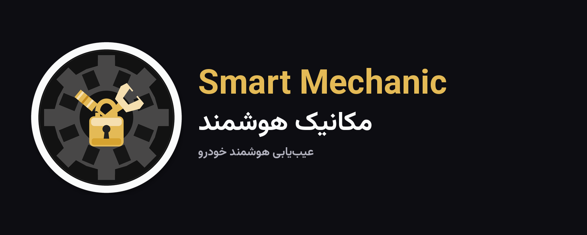

# 🚗 مکانیک هوشمند (Smart Mechanic)

<div align="center">



[](https://flutter.dev)
[](https://dart.dev)
[](https://developer.android.com)
[](RELEASE.md)
[](LICENSE)

**رابط سبک و سریع برای ارسال پرسش‌های خودرو به هوش مصنوعی و نمایش پاسخ آن**

[راهنمای انتشار](RELEASE.md) · [برندینگ](BRANDING.md) · [قوانین استفاده](TERMS.md) · [حریم خصوصی](PRIVACY.md) · [سلب مسئولیت](DISCLAIMER.md)

</div>

---

## ⚠️ سلب مسئولیت

> اپلیکیشن «مکانیک هوشمند» یک ابزار **کمکی و اطلاعاتی** است.  
> تشخیص‌های ارائه‌شده **جایگزین نظر مکانیک حرفه‌ای** نیستند.

متن کامل: [DISCLAIMER.md](DISCLAIMER.md)

---

## ✨ ویژگی‌ها

| ویژگی | توضیح |
|-------|--------|
| 🧠 عیب‌یابی با AI | ارسال مستقیم درخواست به API سازگار با OpenAI در AvalAI با مدل DeepSeek |
| 🚘 انتخاب خودرو | کاتالوگ خودروهای همراه برنامه؛ بدون دریافت کاتالوگ از سرور |
| 📱 پروفایل محلی | ثبت شماره برای پروفایل دستگاه؛ بدون OTP و بدون حساب همگام‌شده با سرور |
| 💳 خرید اعتبار | بسته‌های مصرف‌شدنی از طریق پرداخت درون‌برنامه‌ای کافه‌بازار |
| 📋 تاریخچه | ذخیره و مرور محلی عیب‌یابی‌های قبلی |
| 🌙 تم تاریک/روشن | تنظیمات و تجربهٔ کاربری قابل تغییر |

---

## 🧱 معماری

```
lib/
├── constants.dart
├── main.dart
├── models/
├── providers/                 # Auth, Theme, Locale
├── screens/
├── services/
├── theme/
│   ├── app_theme.dart
│   └── brand.dart             # هویت، رنگ، مسیر لوگو
└── widgets/
    ├── brand_logo.dart
    └── car_selector_widget.dart
```

- **State:** Provider
- **Storage:** SQLite برای پروفایل محلی، اعتبار و تاریخچه؛ SharedPreferences برای تنظیمات زبان، تم و پیش‌نویس‌ها
- **AI:** درخواست مستقیم از اپ به `https://api.avalai.ir/v1/chat/completions` با مدل `deepseek-chat`
- **پرداخت:** خریدهای مصرف‌شدنی کافه‌بازار؛ دفتر اعتبار روی همان دستگاه نگه‌داری می‌شود
- **حساب کاربری:** بدون احراز هویت پیامکی یا همگام‌سازی سروری؛ شماره صرفاً در پروفایل محلی استفاده می‌شود
- **Package ID:** `ir.smartmec.app`

توجه: کلید AI در زمان ساخت به اپ تزریق می‌شود و ممکن است از APK استخراج شود. برای کاهش ریسک، کلید را محدود و مصرف آن را پایش کنید؛ کلید واقعی را در مخزن عمومی قرار ندهید.

---

## 🚀 اجرا

```bash
git clone https://github.com/Tahmoures54/smart-mechanic-flutter.git
cd smart-mechanic-flutter
flutter pub get
python3 tool/generate_branding.py   # اگر آیکون‌ها را از نو می‌سازید
dart run flutter_launcher_icons
flutter run
```

برای ساخت نسخه انتشار و بررسی تنظیمات امضا، [راهنمای انتشار](RELEASE.md) را ببینید.

---

## 📄 مجوز

[MIT](LICENSE)
