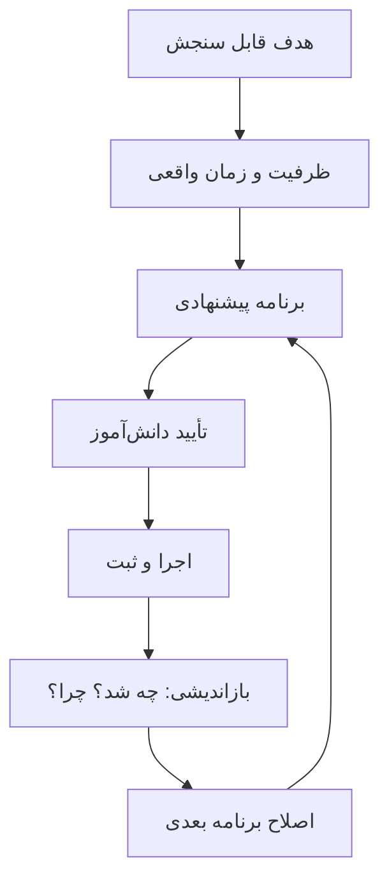

# برنامه‌ریز خودتنظیم نسخه دوم

## ۱. مبنای فعلی
تابع `buildAdaptivePlan` در `learning_engine.dart` برنامه‌ای قطعی برای کارهای ناتمام می‌سازد. اولویت بر اساس میانگین آزمون درس (ضعف بیشتر) و نزدیکی deadline است؛ سقف روزانه clamp شده بین ۱۵ تا ۲۴۰ دقیقه، افق پیش‌فرض ۱۴ روز، روزهای استراحت و فهرست unplaced دارد. محدودیت مهم: زمان آزاد واقعی، انرژی/ترجیح جلسه، زمان رفت‌وآمد یا تقسیم task بزرگ به زیرکار در ورودی نیست؛ task فقط در یک روز قرار می‌گیرد و جابه‌جایی خودکار باید با تأیید کاربر انجام شود. میانگین آزمون نیز mastery واقعی نیست.

## ۲. چرخه SRL

چرخه به زبان ساده: هدف‌گذاری، برنامه‌ریزی، اجرا، خودنظارتی، بازاندیشی و تنظیم مجدد. برنامه‌ریز نباید عدم اجرا را «تنبلی» تفسیر کند.

## ۳. مدل داده پیشنهادی
- `StudyGoal`: id, title, subject/skillIds, targetDate, importance (کاربر تعیین می‌کند), status.
- `AvailabilityBlock`: weekday/date, availableMinutes, preferredStart optional, source=self_reported.
- `StudyTask`: داده legacy حفظ شود؛ فیلدهای optional: estimatedMinutes, remainingMinutes, chunkable, chunkSize, priorityOverride, goalId, status.
- `ExecutionLog`: taskId, startedAt, endedAt, actualMinutes, outcome, interruptionReasonCode.
- `Reflection`: date, energy self-rating optional, perceivedDifficulty, whatWorked, nextAdjustment.
اطلاعات حساس مانند خواب، خلق‌وخو و سلامت وارد نشود؛ اگر انرژی پرسیده می‌شود، اختیاری و فقط برای تنظیم بار روز است.

## ۴. الگوریتم متعادل پیشنهادی
1. ظرفیت هر روز از دسترس‌پذیری اعلام‌شده کاربر به‌دست آید؛ مقدار پیش‌فرض فقط پیشنهاد اولیه باشد.
2. استراحت و حداقل buffer روزانه محفوظ بماند.
3. امتیاز اولویت = وزن اهمیت انتخابی + نزدیکی موعد + شواهد ضعف skill + فاصله از آخرین تمرین؛ همه وزن‌ها قابل توضیح.
4. وظایف بزرگ در صورت اجازه کاربر به بخش‌های ۱۵ تا ۴۵ دقیقه‌ای تقسیم شوند؛ شناسه parent حفظ شود.
5. برنامه به‌صورت greedy با رعایت ظرفیت و تقدم پیش‌نیازها ساخته شود؛ از solver سنگین استفاده نشود.
6. برنامه پیشنهادی با علت هر جابه‌جایی نمایش داده شود؛ کاربر تأیید، رد یا اصلاح کند.
7. پس از اجرا، actualMinutes و status ثبت شود؛ یک روز ناموفق باعث فشرده‌سازی خودکار فردا نشود.
8. بازتنظیم فقط از امروز به بعد؛ گذشته هرگز دستکاری نشود.

### نمونه
ورودی: فردا ۹۰ دقیقه زمان، ۳۰ دقیقه استراحت، ریاضی ۴۵ دقیقه با امتحان سه روز دیگر، زیست ۶۰ دقیقه، زبان ۳۰ دقیقه؛ ظرفیت مؤثر ۶۰ دقیقه.
خروجی: ریاضی ۴۵ دقیقه + ۱۵ دقیقه زبان؛ زیست به روز بعد منتقل و دلیل نمایش داده شود. این فقط پیشنهاد است و دانش‌آموز می‌تواند اولویت را تغییر دهد.

## ۵. واکنش به شرایط
| رویداد | رفتار |
|---|---|
| عقب‌افتادگی | تشخیص تعداد/مدت، پیشنهاد انتخاب مهم‌ترین task؛ نه انتقال دسته‌جمعی |
| امتحان نزدیک | مرور/آزمونک و اولویت موضوعات با شواهد ضعیف |
| کمبود زمان | کاهش حجم، نگه‌داشتن استراحت و هدف حداقلی |
| چند کار هم‌زمان | اولویت شفاف + توضیح trade-off |
| افت عملکرد | افزایش تمرین تشخیصی، نه افزایش کور زمان مطالعه |
| خستگی | امکان سبک‌کردن یا استراحت؛ بدون تشخیص پزشکی |
| تغییر هدف | بستن/ویرایش هدف با تأیید و حفظ تاریخچه |
| اجرای کامل | افزایش تدریجی بار فقط با رضایت؛ نه جهش خودکار |

## ۶. گزینه‌ها
- ساده: حفظ الگوریتم فعلی و اضافه‌کردن تأیید قبل از اعمال.
- متعادل (پیشنهادی): ظرفیت هفتگی، task chunking، execution log و علت‌نمایی.
- پیشرفته: بهینه‌سازی constraint solver و پیش‌بینی بار شناختی؛ فعلاً هزینه و داده کافی نیست.

## ۷. تست‌ها
- بار برنامه از ظرفیت هیچ روز تجاوز نکند.
- روز استراحت حفظ شود.
- task بزرگ فقط با chunkable=true تقسیم شود.
- عدم امکان جاگذاری در unplaced گزارش شود.
- task کامل یا حذف‌شده بازبرنامه‌ریزی نشود.
- جابه‌جایی بدون تأیید به Store اعمال نشود.
- تکرار بازتنظیم نتیجه قطعی یکسان دهد (deterministic).
- تغییر timezone، موعد امروز/فردا و تقویم شمسی تست شود.
- اجرای ناقص موجب فشرده‌سازی خودکار و حذف استراحت نشود.
