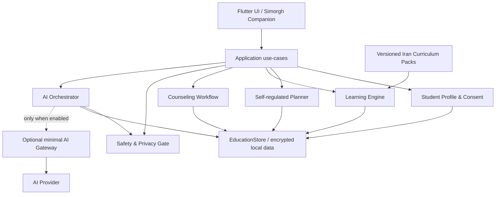
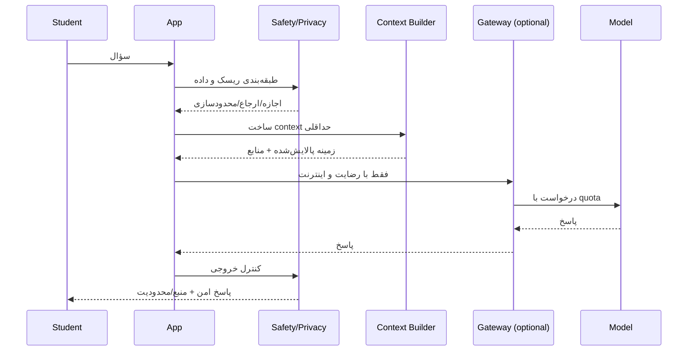

# معماری نسخه دوم سیمرغ
**وضعیت:** پیشنهاد معماری؛ هنوز پیاده‌سازی نشده است  
**مبنای بررسی:** شاخه `main`، commit `6717396c91c0da8d7af966d9e40b741d3b7f7bcb` (۱۸ نوامبر ۲۰۲۶)

## ۱. تصمیم معماری
نسخه دوم باید تکامل تدریجی همین برنامه Flutter/Dart باشد، نه بازنویسی. هسته محلی حفظ می‌شود: `EducationStore`، منطق خالص `learning_engine.dart`، رابط‌های فعلی، رمزنگاری Android Keystore، پشتیبان‌گیری، پرداخت بازار و همراه برداری سیمرغ. افزودن SQLite، موتور ML، سرویس حساب کاربری یا چارچوب state management جدید در نسخه اول توجیه ندارد.

## ۲. وضعیت واقعی مبنا
- `pubspec.yaml`: Flutter/Dart؛ وابستگی‌های مستقیم `http`، `shared_preferences` و SDKهای Flutter؛ افزونه پرداخت بازار از Git با commit ثابت.
- `EducationStore`: داده‌های فضای کاری در کلیدهای `edu.profile`, `edu.tasks`, `edu.exams`, `edu.cards`, `edu.messages`, `edu.reports`, `edu.career.draft`, `edu.deadlines` و کیف پول در `edu.ai.wallet`. داده‌ها با cipher پلتفرمی رمز می‌شوند؛ مهاجرت داده قدیمی در بازشدن Store انجام می‌شود.
- `learning_engine.dart`: SM-2، برنامه‌ریز قطعی بر پایه میانگین آزمون هر درس و موعدها، گزارش روند/پایبندی و قالب پشتیبان نسخه ۱.
- `AiAdvisorService`: درخواست OpenAI-compatible، زمینه پروفایل محدود، حداکثر ۲۴ پیام اخیر معتبر، سقف اندازه درخواست/پاسخ، timeout، abort، جلوگیری از درخواست هم‌زمان تکراری و رزرو/بازپرداخت اعتبار محلی.
- `assessment_pages.dart`: تحلیل تحصیلی با خلاصه محلی نمرات و پرسش‌نامه انتخاب رشته با چهار فیلد علاقه، توانایی خوداظهاری، درس‌های موردعلاقه و سبک کار؛ تحلیل نهایی به AI فرستاده می‌شود.
- `simorgh_companion.dart`: پیام rule-based بر اساس کارهای عقب‌افتاده، مرورهای موعددار، کارهای تکمیل‌شده و پایه؛ بدون استنباط احساس یا ارسال داده.
- پرداخت بازار و دفتر اعتبار محلی‌اند؛ خود سند حریم خصوصی و چک‌لیست انتشار، نبود اعتبارسنجی مالی سمت سرور و قابل استخراج بودن کلید AI داخل APK را صریحاً اعلام می‌کنند.
- در مخزن ۱۱ فایل آزمون Dart در `test/` دیده می‌شود. آخرین چک‌لیست انتشار ثبت‌شده ۵۳ آزمون موفق را برای اجرای مشخص‌شده گزارش می‌کند؛ این عدد را نباید به اجرای فعلی تعمیم داد. در این مأموریت هیچ تستی اجرا نشده است.

## ۳. معماری منطقی پیشنهادی

### لایه‌ها
1. **Presentation:** صفحات موجود؛ فقط نمایش state و گرفتن تأیید کاربر.
2. **Application:** use-caseهای کوچک مانند `RecordPracticeAttempt`, `ReplanWeek`, `BuildStudentContext`.
3. **Domain:** مدل تسلط، زمان‌بندی، قواعد مشاوره، ایمنی؛ Dart خالص و مستقل از Flutter.
4. **Data:** repository روی `EducationStore` فعلی؛ نسخه‌بندی و مهاجرت.
5. **Content:** بسته‌های JSON امضاشده و نسخه‌دار؛ بدون پایگاه‌داده بزرگ.
6. **AI boundary:** ساخت context حداقلی، policy، درخواست، اعتبارسنجی خروجی و ثبت feedback.
7. **Optional gateway:** فقط برای مخفی‌سازی کلید، quota و کنترل هزینه؛ نه برای ذخیره پرونده دانش‌آموز.

## ۴. اصول غیرقابل نقض
- پیش‌فرض offline-first؛ قابلیت‌های برنامه‌ریزی، ثبت تمرین، مرور و گزارش بدون شبکه کار کنند.
- داده روان‌شناختی تشخیصی جمع‌آوری نشود. پرسش‌نامه‌های خودگزارشی صرفاً نشانه/بازتاب‌اند، نه تشخیص.
- هر پیشنهاد الگوریتمی باید دلیل قابل فهم، داده ورودی و سطح اطمینان داشته باشد.
- هیچ برنامه‌ای بدون تأیید دانش‌آموز وظایف را جابه‌جا یا حذف نکند.
- AI منبع حقیقت برای نمره، قوانین کنکور، کتاب درسی یا وضعیت مالی نیست.
- اطلاعات مالی، توکن خرید و کیف پول هرگز وارد context هوش مصنوعی یا پشتیبان فضای کاری نشوند.
- هر قابلیت جدید feature-flag و قابل خاموش‌کردن باشد.

## ۵. گزینه‌های معماری
| حوزه | ساده | متعادل (انتخاب) | پیشرفته |
|---|---|---|---|
| داده محلی | SharedPreferences فعلی | Repository و schema نسخه‌دار روی Store فعلی؛ مهاجرت تدریجی | SQLite/Drift |
| تسلط | قواعد امتیازی | mastery evidence شفاف، سپس BKT پس از داده | مدل IRT/ML شخصی |
| محتوا | ثابت داخل کد | JSON نسخه‌دار، cache و امضای دیجیتال | CMS و sync کامل |
| AI | کلید داخل APK | Gateway stateless اختیاری با quota | backend حساب/پروفایل/تحلیل |
| state UI | الگوی فعلی | use-case + notifierهای کوچک | state framework سراسری |

انتخاب متعادل به دلیل کم‌هزینه بودن، حفظ حجم APK، قابلیت تست و مهاجرت محدود است.

## ۶. نقشه ماژول‌ها و فایل‌ها
ساختار فعلی `lib/education/` شامل صفحات، Store، engine، AI، پرداخت و companion است. ابتدا همان ساختار حفظ شود. بعد از تثبیت، فایل‌های domain خالص به زیرپوشه‌های `domain/` و use-caseها به `application/` منتقل شوند؛ این جابه‌جایی نباید در یک PR بزرگ انجام شود.

| موجود | نقش نسخه ۲ |
|---|---|
| `learning_engine.dart` | حفظ؛ جداسازی توابع و توسعه مدل شواهد |
| `education_store.dart` | حفظ؛ repository facade و schema migrations |
| `ai_advisor_service.dart` | حفظ؛ تبدیل به orchestrator با policy modules |
| `assessment_pages.dart` | حفظ UI؛ انتقال منطق پرسش‌نامه به domain |
| `study_pages.dart` | حفظ؛ نمایش برنامه و تمرین |
| `simorgh_companion.dart` | حفظ نقاشی و پیام‌های مبتنی بر رویداد |
| `bazaar_billing_service.dart` | حفظ؛ مرز مالی مستقل |
| `backup_page.dart` | حفظ؛ نسخه‌بندی و سازگاری |

پیشنهاد فایل‌های آتی: `student_model.dart`, `practice_attempt.dart`, `mastery_estimator.dart`, `planner_policy.dart`, `curriculum_manifest.dart`, `content_repository.dart`, `ai_context_builder.dart`, `ai_safety_policy.dart`, `counseling_workflow.dart`. این‌ها نام پیشنهادی‌اند، نه فایل موجود.

## ۷. نمودار جریان درخواست AI

## ۸. ریسک‌ها و تصمیم انتشار
بزرگ‌ترین ریسک‌ها: کلید قابل استخراج، دفتر اعتبار محلی و غیرقابل‌انتقال، عدم وجود منبع رسمی نسخه‌دار در پاسخ‌های factual، فقدان مدل تسلط مبتنی بر پاسخ سؤال، و نبود فرآیند رضایت/ارجاع کامل برای افراد کم‌سن. این‌ها باید به‌صورت صادقانه در محصول و سیاست حریم خصوصی توضیح داده شوند.

**پاسخ نهایی:** معماری offline-first برای هسته محصول مناسب است؛ برای حفاظت از کلید و quota، gateway سبک و stateless توصیه می‌شود. اعتبارسنجی خرید واقعی و قابل اتکا، در صورت نیاز تجاری، بدون مرجع سمت سرور تضمین‌پذیر نیست. تا اجرای پایلوت و ارزیابی مستقل، ادعای اثربخشی یا رقابت بین‌المللی مجاز نیست.

## ۹. منابع راهنما
- Corbett & Anderson (1994), Knowledge tracing: https://doi.org/10.1007/BF01099821
- Ruitenburg et al. (2026), classroom retrieval/spacing/interleaving meta-analysis: https://doi.org/10.1007/s10648-026-10225-5
- UNESCO (2023, updated 2026), human-centred GenAI guidance: https://www.unesco.org/en/articles/guidance-generative-ai-education-and-research
- Holland, Making Vocational Choices (1997).
- Lent, Brown & Hackett (1994), SCCT: https://doi.org/10.1006/jvbe.1994.1027
